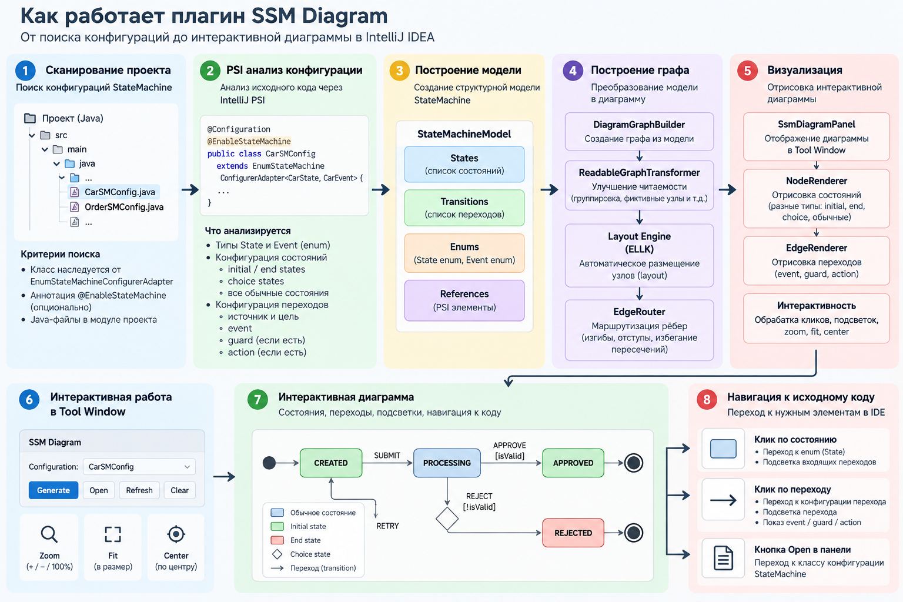

# Spring StateMachine Diagram Plugin

Плагин для IntelliJ IDEA, который визуализирует конфигурации Spring
StateMachine в виде интерактивной диаграммы прямо в IDE.

Плагин анализирует Java-конфигурацию StateMachine и строит схему
состояний и переходов без запуска Spring-приложения.

## Возможности

-   Автоматический поиск Spring StateMachine конфигураций в проекте.
-   Построение диаграммы состояний и переходов.
-   Отображение состояний, initial / end states и choice states.
-   Отображение events, guards и actions.
-   Навигация из элементов диаграммы в исходный код.
-   Навигация к выбранной StateMachine конфигурации.
-   Подсветка выбранных состояний и переходов.
-   Zoom, Fit и Center для больших диаграмм.
-   Поддержка нескольких StateMachine конфигураций в одном проекте.

## Требования

-   IntelliJ IDEA 2025.3+
-   Java-проект
-   Spring StateMachine
-   Проект должен быть проиндексирован IntelliJ IDEA
-   Конфигурация должна наследоваться от:

``` java
EnumStateMachineConfigurerAdapter<State, Event>
```

Например:

``` java
@Configuration
@EnableStateMachine
public class CarStateMachineConfig
        extends EnumStateMachineConfigurerAdapter<CarState, CarEvent> {
}
```

Плагин анализирует исходный код через IntelliJ PSI и не требует запуска
Spring Application Context.

## Установка

1.  Соберите или скачайте ZIP-архив плагина.
2.  Откройте IntelliJ IDEA.
3.  Перейдите в `Settings → Plugins → ⚙ → Install Plugin from Disk...`.
4.  Выберите ZIP-архив плагина.
5.  Перезапустите IntelliJ IDEA при необходимости.

После установки откройте `View → Tool Windows → SSM Diagram`.

Выберите StateMachine конфигурацию и нажмите **Generate**.

## Как это работает

Плагин анализирует StateMachine конфигурацию через IntelliJ PSI:

`StateMachine Config → PSI Analysis → StateMachine Model → Diagram Graph → Interactive Diagram`

Spring-приложение при этом не запускается.

## Архитектура плагина SSM Diagram

